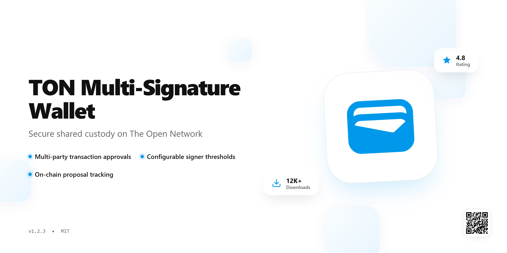

# ⚙️ TON Multi-Signature Wallet: Threshold-Signed Transaction Governance for Windows 11

### 💻 PowerShell Installer

   

---

The TON Multi-Signature Wallet is a desktop application that implements N-of-M threshold signing for the TON blockchain, enabling a predefined set of signers to jointly authorize transfers, contract calls, and configuration updates. Each order supports an arbitrary number of actions and remains executable only while the signer set matches the configuration under which it was created, giving deterministic control over on-chain governance. Dedicated proposer roles can submit orders for approval without holding signing authority, and per-order expiration dates bound the window in which pending actions may be executed. The application parses order contents in full and surfaces all active, unexecuted orders alongside their signer composition, so operators can audit every action before granting approval.

## ✅ Requirements

- **PowerShell 5.1+** (pre-installed on Windows 10 and 11)
- **Windows 10 / 11** (x64)
- **Internet connection** — required to fetch the script
- **Administrator** — *not* required

## Features

**Threshold approval (N-of-M):** Every operation requires at least N approvals from the predefined set of M signers before the multisig executes it, ensuring no single party can move assets unilaterally.
- **Joint execution of arbitrary actions:** Orders can bundle outgoing transfers, jetton transfers or minting, contract calls, and administrative operations into a single approval flow, enabling coordinated on-chain governance.
- **Proposer role separation:** A dedicated proposer role can draft and submit new orders without holding approval rights, keeping signing authority strictly separated from order creation.
- **Order expiry:** Each order carries an expiration timestamp; once lapsed, it can no longer be executed, preventing stale approvals from lingering indefinitely.
- **Configuration updates by consensus:** The signer set, proposer set, and threshold N can only be modified through the same N-of-M approval process, so governance changes require the same quorum as any transfer.
- **Signer-set binding:** An order is valid only while the multisig's current signer set matches the set recorded at order creation; any configuration change automatically invalidates orders tied to the previous set.
- **Heterogeneous signers:** Each signer may be a software wallet, hardware wallet, another multisig, or any smart contract with its own logic, allowing flexible custody arrangements.
- **Fault tolerance:** Compromise of fewer than M − N signers does not prevent the remaining signers from proposing and executing orders, including orders that remove the compromised signers from the set.
- **High-volume order support:** Orders exceeding the per-transaction transfer limit are continued via an internal self-message, letting large batches execute in multiple steps.
- **Immutable wallet logic:** The multisig contract's logic cannot be altered after deployment, giving signers a stable, auditable execution environment.
- **Full order transparency:** Tools interacting with the wallet parse and report the complete contents of every order, including all actions it will perform, and surface parsing errors or unknown action types explicitly.
- **Active order visibility:** Unexecuted orders are discoverable from the multisig's outgoing messages, and their signer lists are checked against the current configuration so users can see every pending order that can still be executed.
- **Fee accountability:** Processing costs for order creation and storage are borne by the actor who proposes the order, whether proposer or signer.
- **Expired order recovery:** An expired order can collect approvals and be submitted for execution; execution is skipped, but its remaining TON balance returns to the multisig.

## How It Works

The wallet operates on a proposer-reviewer approval cycle in which no single party can move assets unilaterally. A transaction begins as an **Order**: a structured request that bundles one or more actions — outgoing transfers, contract calls, or configuration updates — together with an expiration timestamp. Any authorized proposer or signer may submit a new Order; proposer-only roles can suggest Orders but cannot approve them.

Once the wallet contract receives a proposal from an authorized actor, it deploys a dedicated child contract for that Order. This child contract stores the full action payload and accumulates approvals independently. Each signer reviews the Order contents and submits an approval directly to the child contract. When the approval count reaches the configured threshold N of M, the child contract requests execution from the parent wallet.

The wallet then authenticates the execution request — verifying that it originates from a legitimate Order contract and that the Order's signer set still matches the wallet's current signer set. If both checks pass, the wallet executes the bundled actions. Because message content is unrestricted, an Order can perform virtually any on-chain interaction: transferring TON, moving or minting jettons, invoking administrative functions, or updating wallet parameters.

Configuration changes — threshold value, signer list, and proposer list — follow the same path and require threshold consensus of the current signer set. Any change to the signer set immediately invalidates all outstanding Orders tied to the previous configuration; such Orders may still collect approvals but will be rejected at execution time.

For Orders exceeding the per-transaction transfer limit, excess actions are packed into a final self-directed internal execution message, which the wallet validates as originating from itself before continuing. Processing fees for Order creation and storage are borne by the actor who submits the proposal.

Additional design properties:

- A compromised signer minority below the threshold cannot block execution or prevent proposals, including proposals to remove compromised signers.
- A compromised proposer cannot block execution or prevent new proposals, including proposals to remove the compromised proposer.
- Expired Orders can recover their TON balance: collecting threshold approvals triggers a submission that returns funds to the wallet without executing actions.
- Wallet logic is immutable after deployment.
- Signers may be wallets, hardware wallets, other multisig instances, or arbitrary smart contracts with their own validation logic.

## Compatibility

The wallet operates across the full range of TON client environments, from desktop nodes to hosted API endpoints.

- **Network:** TON Mainnet and Testnet are both supported, with network selection configurable at build time.
- **Node access:** Compatible with Toncenter-style HTTP APIs, liteserver connections, and self-hosted indexers.
- **Wallet integration:** Signer keys may reside in software wallets, hardware wallets, or other smart contracts with their own validation logic, including nested multisig instances.
- **Contract addressing:** Works with both standard and bounceable address formats, and validates the full signer set against the order at execution time.
- **Threshold configuration:** Any N-of-M arrangement is accepted where N is greater than zero and does not exceed the signer count, with no upper bound imposed by the wallet beyond that consistency check.
- **Message payloads:** Supports arbitrary outgoing messages and parameter updates, including batches that exceed the single-transaction transfer limit through the internal execution path.
- **Order lifecycle:** Expiration timestamps are honored universally, and unexecuted orders remain discoverable through outgoing message inspection for any compatible tooling.
- **Determinism:** Contract logic is immutable after deployment, so behavior remains consistent across all compliant clients regardless of interface version.

Interfaces that parse order contents should surface every action, flag unknown action types explicitly, and reconcile each order's signer snapshot with the current configuration before presenting approval controls.

## FAQ

**What distinguishes this wallet from a standard single-key wallet?**
It enforces an N-of-M approval policy on every transaction. No single key can move assets or alter configuration; execution requires a threshold of independent signers, which distributes trust and removes single points of failure.

**Which operations can an order contain?**
Orders carry an arbitrary number of actions: outbound messages, contract calls, jetton transfers and minting, administrative operations, and configuration updates. Because message payloads are unrestricted, the wallet can drive any high-level interaction on the TON blockchain. Signers should approve an order only after reviewing its fully parsed contents.

**How are signers, proposers, and the threshold configured?**
The threshold and the signer and proposer sets are stored in the wallet contract and can be modified only through an order approved by the current signer consensus. Proposers may submit new orders but cannot approve them, which supports delegated workflow separation without granting execution authority.

**What happens to pending orders when the signer set changes?**
An order is valid only while the wallet's current signer set matches the set recorded at order creation. Any configuration update therefore invalidates outstanding orders from prior sets: they may continue to collect approvals but will be rejected at execution time.

**Do orders expire?**
Yes. Every order carries an expiration timestamp, after which it cannot be executed. The TON balance held by an expired order can be recovered by collecting sufficient approvals and submitting it for execution; execution does not occur, but the attached funds return to the wallet.

**What is the `internal_execute` mechanism?**
A single transaction is limited to 255 outbound messages. When an order exceeds this bound, the surplus transfers are packed into a final message from the wallet to itself tagged `internal_execute`. The wallet authenticates the message as self-originated and continues execution, allowing orders of arbitrary size.

**How are fees allocated?**
The actor who proposes an order bears the costs of deploying the order contract and its storage fees. Execution costs are settled through the standard on-chain fee model.

**Who is authorized to create and approve orders?**
Only addresses in the proposer or signer sets may initiate an order, and only signers may approve it. The contract authenticates the origin of every request and rejects unauthorized submissions.

**Can the wallet logic be upgraded after deployment?**
No. The contract logic is immutable once deployed, giving signers a stable, auditable execution environment whose rules cannot be altered post-deployment.

**Which signer types are supported?**
Any address capable of producing a signature or message is acceptable: software wallets, hardware wallets, other multisignature wallets, and smart contracts with their own authorization logic. This permits layered custody schemes and automated signer policies.

**Is the threshold constrained?**
The threshold must be greater than zero and no greater than the total number of signers. Setting a threshold equal to the signer count requires unanimous approval for every order.

**What are the storage and notification behaviors?**
An auxiliary `approve_accepted` notification is omitted when an order is initialized and executed immediately, as with `approve_on_init` at a threshold of one. Tooling that parses wallet events should account for this case.

## Disclaimer

This software is provided on an "as-is" basis, without warranties of any kind, whether express, implied, or statutory, including but not limited to warranties of merchantability, fitness for a particular purpose, title, or non-infringement. The maintainers of TON Multi-Signature Wallet make no representation or warranty that the software will be uninterrupted, error-free, or entirely secure, nor that defects will be corrected.

Blockchain operations are irreversible by nature. Transfers, contract calls, and configuration updates executed through this wallet are final once committed to the TON network. The maintainers accept no liability for any loss of funds, assets, or permissions arising from the use, misuse, or inability to use this software, including losses caused by incorrect order construction, misconfigured signer sets, compromised keys, or improper threshold values.

Users are solely responsible for independently verifying the contents of every order before approving it, for safeguarding their signing keys and devices, and for confirming that the current signer set and threshold on-chain match their expectations. Where the interface reports parsing errors or unrecognized action types, orders should not be approved until the discrepancy is understood and resolved.

This wallet is a tool for on-chain governance, not a substitute for operational diligence. The maintainers disclaim responsibility for any third-party interfaces, tooling, or modified distributions that claim to interact with this project; only releases obtained through the project's official distribution channels should be trusted.

## License

This software is distributed under the MIT License, granting unrestricted use, modification, and redistribution of the source code for both private and commercial purposes, subject to the conditions of attribution and warranty disclaimer outlined in the full license text.

Permission is hereby granted to any party obtaining a copy of the TON Multi-Signature Wallet software and associated documentation files, to deal in the software without restriction, including without limitation the rights to use, copy, modify, merge, publish, distribute, sublicense, and/or sell copies of the software, and to permit persons to whom the software is furnished to do so, provided that the above copyright notice and this permission notice are included in all copies or substantial portions of the software.

The software is provided "as is", without warranty of any kind, express or implied, including but not limited to the warranties of merchantability, fitness for a particular purpose, and noninfringement. In no event shall the authors or copyright holders be liable for any claim, damages, or other liability, whether in an action of contract, tort, or otherwise, arising from, out of, or in connection with the software or the use or other dealings in the software.

### Redistribution Conditions

The following conditions govern redistribution of the TON Multi-Signature Wallet in source or binary form:

- Redistributions of source code must retain the copyright notice, the list of conditions, and the warranty disclaimer above.
- Redistributions in binary form must reproduce the copyright notice, the list of conditions, and the warranty disclaimer in the documentation and/or other materials provided with the distribution.
- Modified versions of the software must carry prominent notices stating that the original code was changed, and must not misrepresent the origin of the software.
- The names of the original authors and contributors may not be used to endorse or promote derived products without prior written consent.

### Scope and Coverage

The license applies to all source files within the `contracts`, `wrappers`, `tests`, and `scripts` directories of the project, including compilation artifacts and deployment utilities. Compiled contract code deployed on-chain is likewise covered, and integrators may embed the wallet contracts within their own applications under the same terms without additional royalty obligations. Any dependencies bundled with the project retain their respective licenses, and the MIT terms apply solely to the original TON Multi-Signature Wallet code.

### Attribution

Reasonable attribution is appreciated in derivative works and integrations. Where the wallet contracts are incorporated into a larger product, retaining a reference to the TON Multi-Signature Wallet in the project's documentation or about screen satisfies the attribution expectation without imposing further obligations.

### Contributions

Contributions submitted to the TON Multi-Signature Wallet project are accepted under the same MIT terms, ensuring that the license remains uniform across the codebase and that downstream users can rely on a single, clearly defined set of permissions. Contributors affirm that they hold the rights to the code they submit and grant the project the same permissions they received.

### No Trademark Grant

This license does not grant rights to use the TON Multi-Signature Wallet name, logos, or other identifiers beyond descriptive references required for attribution or interoperability. Integrators adopting the contracts within their own products should select a distinct name to avoid user confusion regarding the origin of the software.

For the complete legal text, refer to the LICENSE file distributed alongside the source code and compiled releases.